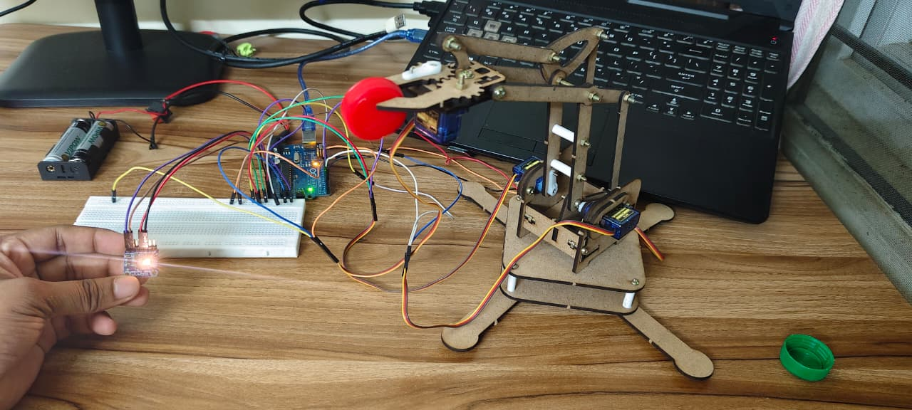
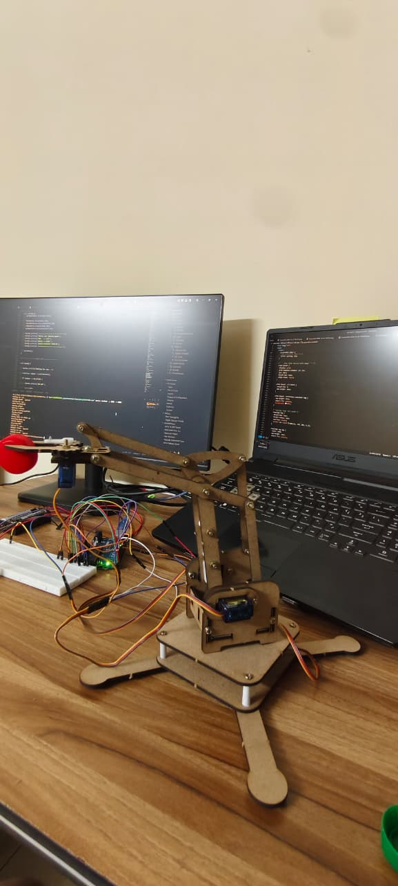
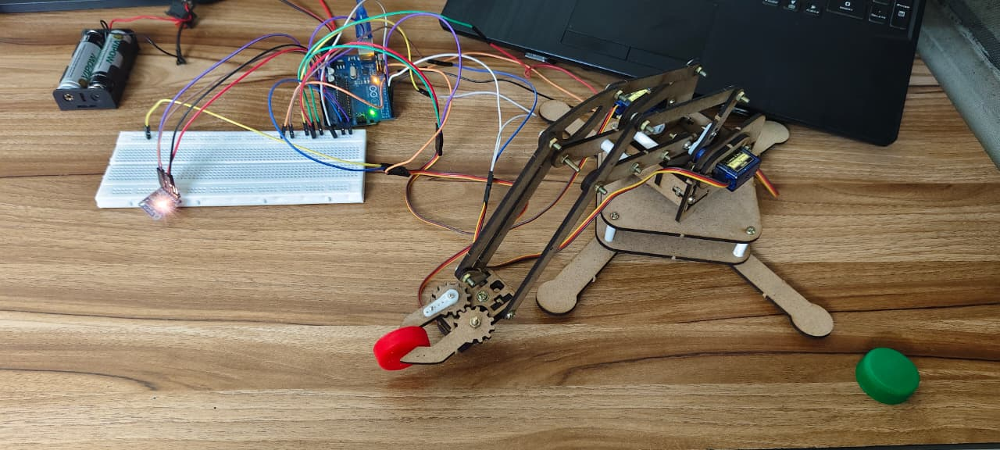
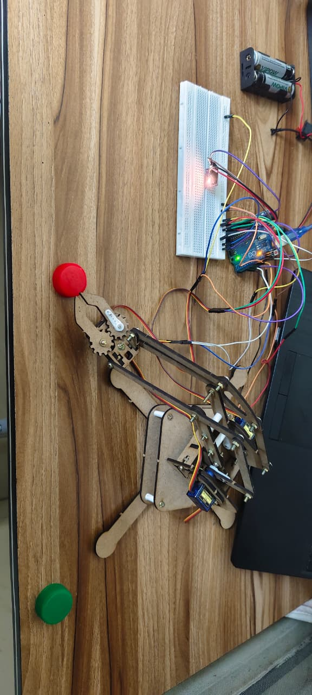
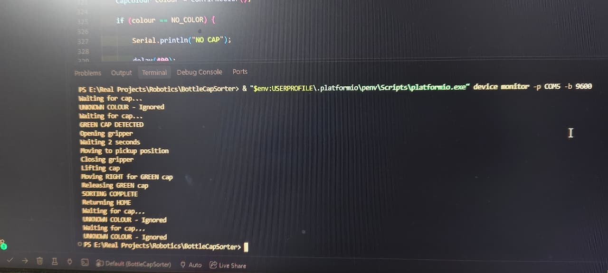
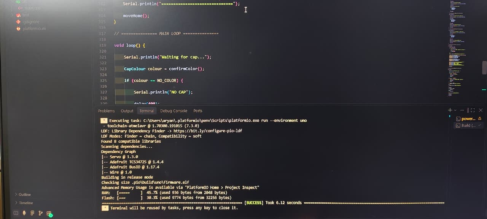

# CapSortX: Automated Bottle Cap Sorting Robot

<p align="center">
  
</p>

<p align="center">
  <strong>Autonomous Colour-Based Pick-and-Place Robotic Arm & Industrial Digital Twin</strong>
  <br />
  <em>Department of CINTEL & NWC, SRM Institute of Science and Technology, Kattankulathur</em>
</p>

<p align="center">
  <a href="https://github.com/singharyan006/capsortx"></a>
  
  
  
</p>

---

## 📌 Executive Summary

Manual sorting of small objects such as bottle caps in industrial recycling and manufacturing setups is slow, repetitive, and prone to human error caused by eye strain and fatigue. 

**CapSortX** solves this problem by combining:
1. **Physical Prototype:** An autonomous 4-DOF articulated robotic arm driven by four SG90 micro-servos, an active TCS34725 I²C RGB colour sensor with white LED illumination, an IR proximity gate sensor, and an Arduino UNO executing custom deterministic state-machine C++ firmware.
2. **Industrial Digital Twin:** A high-fidelity, real-time 3D simulation built with Three.js WebGL and analytical forward kinematics. It incorporates an automated motorized infeed conveyor belt, continuous sample smoothing, ambient optical noise modeling, and segregated 4-bin categorization (Red, Green, Blue, and Unknown/Reject).

```
[ SENSE ] ──► [ THINK ] ──► [ ACT ] ──► [ RETURN ] ──► [ REPEAT ]
```

---

## 📷 Physical Apparatus & Hardware Build

| **Complete Workstation & Development Setup** | **Apparatus & Sensor Calibrations** |
|:---:|:---:|
|  |  |
| *Figure 1: Complete setup with laptop, Arduino, and 4-DOF arm.* | *Figure 2: Active illuminated sensing station & prototype base.* |

| **Optical Color Inspection & Alignment** | **End-Effector Parallel Gripper Grasping** |
|:---:|:---:|
|  |  |
| *Figure 3: TCS34725 RGB sensor array with onboard LED.* | *Figure 4: Symmetric gear-driven gripper securing a cap.* |

---

## 🏛️ System Architecture: The 5-Layer Model

The system operates across a modular 5-layer robotics architecture:

```
┌────────────────────────────────────────────────────────────────────────┐
│ 1. PHYSICAL LAYER                                                      │
│    Laser-cut MDF structure, 4-DOF linkage, symmetrical spur gripper,   │
│    motorized infeed conveyor, sorting containers, 2S 18650 Li-ion pack │
├────────────────────────────────────────────────────────────────────────┤
│ 2. SENSING LAYER                                                       │
│    • IR Proximity Gate (Digital Pin 2) -> Object arrival trigger       │
│    • TCS34725 16-bit RGBC Photodiode Array + IR filter (I²C 0x29)      │
├────────────────────────────────────────────────────────────────────────┤
│ 3. COMMUNICATION LAYER                                                 │
│    • Fast I²C Bus (SDA / SCL @ 400 kHz) for optical sensor data       │
│    • USB Serial Interface (9600 baud) for diagnostics and event telemetry│
├────────────────────────────────────────────────────────────────────────┤
│ 4. CONTROL (DECISION) LAYER                                            │
│    • Arduino UNO (ATmega328P @ 16 MHz)                                 │
│    • Normalized Color Space Analysis ($n_r, n_g, n_b$)                 │
│    • Multi-sample averaging, noise rejection, & 14-state sequencer     │
├────────────────────────────────────────────────────────────────────────┤
│ 5. ACTUATION LAYER                                                     │
│    • 4× SG90 Servos (Base: Pin 3, Shoulder: Pin 5, Elbow: Pin 6,      │
│      Gripper: Pin 9) controlled with smooth 50 Hz PWM interpolation    │
└────────────────────────────────────────────────────────────────────────┘
```

---

## ⚙️ Hardware Specifications & Circuit Connections

### Component Summary

| Component | Specification / Model | Operating Role |
| :--- | :--- | :--- |
| **Microcontroller** | Arduino UNO Rev3 (ATmega328P @ 16 MHz) | Master controller & decision sequencer |
| **Colour Sensor** | ams TCS34725 RGB + Clear Light-to-Digital | 16-bit ADC per channel, I²C address `0x29` |
| **Proximity Sensor** | Active IR Optical Sensor Module | Triggers inspection cycle when beam is broken |
| **Actuators** | 4× TowerPro SG90 Micro Servos (1.8 kg·cm) | Joints: Base rotation, Shoulder, Elbow, Gripper |
| **Mechanical Arm** | Laser-Cut MDF (Medium-Density Fibreboard) | 4-DOF articulated geometry with parallel linkage |
| **Power Supply** | 2S 18650 Li-ion Cells (7.4 V nominal) + Buck | Servos on regulated 5 V rail (≥ 3 A); Arduino VIN |
| **Coupling / End Effector** | Dual-gear symmetrical clamp | Grips flat cylindrical rims (dia: 3.0 cm) |

### Electrical Wiring & Pinout

```
  ┌─────────────────────────────────────────────────────────────┐
  │                        ARDUINO UNO                          │
  │                                                             │
  │   [D2] ◄──────── Digital OUT ──────── [IR Proximity Sensor] │
  │   [D3] ───────── PWM Signal ───────── [Servo 1 · Base]      │
  │   [D5] ───────── PWM Signal ───────── [Servo 2 · Shoulder]  │
  │   [D6] ───────── PWM Signal ───────── [Servo 3 · Elbow]     │
  │   [D9] ───────── PWM Signal ───────── [Servo 4 · Gripper]   │
  │   [A4] ◄──────── SDA (Data) ───────── [TCS34725 Sensor]     │
  │   [A5] ───────── SCL (Clock) ──────── [TCS34725 Sensor]     │
  │   [5V] ───────── Logic VCC ────────── Sensors               │
  │   [GND] ──────── Common Ground ────── System Ground         │
  └─────────────────────────────────────────────────────────────┘
                               ▲
                               │ 5V Regulated Rail (≥ 3A)
                  ┌───────────────────────────┐
                  │ 5V Step-Down Buck / UBEC  │
                  └───────────────────────────┘
                               ▲
                               │ 7.4 V Raw
                  ┌───────────────────────────┐
                  │  2S 18650 Li-Ion Battery  │
                  └───────────────────────────┘
```

> **⚡ Electrical Safety Rule:** SG90 servos cannot tolerate raw 2S battery voltage (~8.4 V max). Power is stepped down to 5 V via an external buck regulator. Ground pins between the Arduino, sensor breakout, buck converter, and servo rail are joined together to maintain a common signal reference.

---

## 🧠 Scientific Colour Normalization & Classification Algorithm

Raw light intensities change under shifting ambient illumination and varying cap surface reflections. To achieve high classification accuracy, raw readings $(R, G, B)$ are normalized relative to their total chromatic energy:

$$\text{Sum} = R + G + B$$

$$n_r = \frac{R}{\text{Sum}}, \quad n_g = \frac{G}{\text{Sum}}, \quad n_b = \frac{B}{\text{Sum}}$$

### Decision Matrix

| Color Class | Normalization Conditions | Destination Target | Container Base Pose |
| :--- | :--- | :--- | :--- |
| **NO CAP** | $C < 100$ | Station Idle / Conveyor Advance | Wait |
| 🔴 **RED** | $n_r > 0.45 \quad \text{and} \quad n_g < 0.30$ | **Bin 1 (Far Left)** | $\text{Base} = 155^\circ$ |
| 🟢 **GREEN** | $n_g > 0.41, \; n_r < 0.30, \; n_b < 0.29$ | **Bin 2 (Mid Left)** | $\text{Base} = 120^\circ$ |
| 🔵 **BLUE** | $n_b > 0.42 \quad \text{and} \quad n_r < 0.25$ | **Bin 3 (Mid Right)** | $\text{Base} = 60^\circ$ |
| 🟡 **UNKNOWN** | Any color failing known criteria | **Bin 4 (Far Right)** | $\text{Base} = 25^\circ$ |

```
               [ Cap Present at Inspection Pad? ]
                              │
                    Yes       ▼       No
           ┌────────────────────────────────────┐
           │ Read TCS34725 (R, G, B, Clear)     │ ──► [ Status: NO CAP ]
           │ Take 6 samples & calculate average │
           └──────────────────┬─────────────────┘
                              ▼
                   [ Clear Channel >= 100? ]
                     /                 \
             Yes    /                   \   No
                   ▼                     ▼
          [ Evaluate Rules ]        [ Station Clear ]
           /       │       \
          /        │        \
         ▼         ▼         ▼
     [ RED ]   [ GREEN ]  [ BLUE ]  ──► [ Else: UNKNOWN / REJECT ]
      Bin 1      Bin 2      Bin 3                   Bin 4
```

---

## 🧪 Firmware Compilation & Hardware Verification

The embedded firmware was developed in modern C++ using **PlatformIO** under the AVR toolchain. The code footprint easily fits inside the ATmega328P microcontroller with plenty of headroom:

<p align="center">
  
  <br />
  <em>PlatformIO Build: Flash 30.3% (9,774 B / 32,256 B) · RAM 45.7% (936 B / 2,048 B).</em>
</p>

### Runtime Serial Diagnostics

Real-time telemetry streams over USB serial (9600 baud) for monitoring every state transition:

<p align="center">
  
  <br />
  <em>Live UART console displaying cap sensing, color classification, pick, and drop execution.</em>
</p>

```text
[UART 9600] Waiting for cap...
[UART 9600] GREEN CAP DETECTED
[UART 9600] Opening gripper
[UART 9600] Moving to pickup position
[UART 9600] Closing gripper
[UART 9600] Lifting cap
[UART 9600] Moving RIGHT for GREEN cap
[UART 9600] Releasing GREEN cap
[UART 9600] SORTING COMPLETE
[UART 9600] Returning HOME
```

---

## 🌐 3D Digital Twin & Interactive Simulation

The project includes an interactive 3D digital twin built with **Three.js WebGL** that directly mirrors the kinematics, conveyor mechanics, and state machine of the physical robot:

```
┌────────────────────────────────────────────────────────────────────────┐
│                        CAPSORTX 3D SIMULATION                          │
│                                                                        │
│   [Conveyor Infeed] ──► [Optical Station] ──► [4-DOF Pick & Place]     │
│          ▲                         │                      │            │
│          │                         ▼                      ▼            │
│    Active Belt              TCS34725 Model        4 Segregated Bins    │
│    (Continuous Flow)        (RGBC + Noise)        (Red / Grn / Blu / ?)│
│                                                                        │
│   Live Dashboard:                                                      │
│   • Forward Kinematics (X, Y, Z, Reach, Grip Opening)                  │
│   • Real-Time RGBC Spectrum Meters & Normalized Ratio Thresholds       │
│   • Synchronized 14-State Deterministic Machine Tracker                │
│   • Manual Joint Angle Jogging & Predefined Movement Sequences         │
└────────────────────────────────────────────────────────────────────────┘
```

- **Motorized Infeed Conveyor:** Simulates the continuous infeed of caps arriving at the TCS34725 optical inspection pad.
- **Real-Time Forward Kinematics:** Computes the live end-effector position $(x, y, z)$ in centimeters.
- **Automated 4-Bin Sorter:** Segregates Red, Green, Blue, and Unknown caps into dedicated bins.
- **Diagnostics Dashboard:** Visualizes raw RGBC bar meters, normalized ratios, active classification rules, and cycle counters.

> 💡 **Tip to save a simulation snapshot:** When you launch the web app locally, take a screenshot of the 3D twin canvas and save it as `public/sim.png` to display your personal simulation view directly in this section!

---

## 🚀 Quick Start Guide

### 1. Build and Run the Digital Twin Web App
```bash
# Clone the repository
git clone https://github.com/singharyan006/capsortx.git
cd capsortx

# Install dependencies
npm install

# Build the production bundle
npm run build

# Start a local static server
npx serve dist
```
Open [http://localhost:3000](http://localhost:3000) in any modern browser.

### 2. Flashing the Arduino Firmware
```bash
# Navigate to the firmware workspace
cd firmware   # or open in VS Code with PlatformIO

# Build and upload to Arduino UNO
pio run --target upload

# Open the serial monitor
pio device monitor -b 9600
```

---

## Academic Contributions

*Submitted in partial fulfilment of the requirements for the course **Introduction to Robotics** (Academic Year 2026–2027), Faculty of Engineering and Technology, **SRM Institute of Science and Technology**, Kattankulathur.*


**Course Faculty & Project Guide:**  
Dr. Vamsi Krishna Dommeti, Assistant Professor, Department of CINTEL & NWC

---

## 📄 License
This project is released under the [MIT License](LICENSE) for open academic and educational use.
